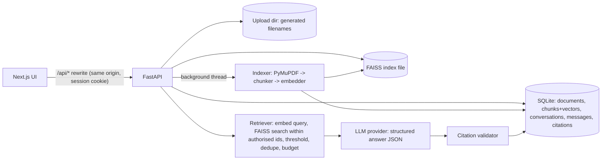

# Architecture & implementation checklist

PDF Intelligence is a **local, single-user** RAG application. This document records the design decisions;
the README covers setup and usage.

## Key decisions

| Topic | Decision | Why |
|---|---|---|
| Source of truth | SQLite holds chunks **and their embedding blobs**. FAISS is a derived, rebuildable index. | A crash between "DB commit" and "index write" is repaired on startup by `VectorStore.reconcile`. |
| Vector filtering | Authorised chunk ids are resolved from SQLite (owner, status=ready, selected documents) and passed to FAISS as an `IDSelector`. | Retrieval can never return a chunk outside the caller's scope. |
| Owner isolation | Random 128-bit capability cookie (`HttpOnly`, `SameSite=Lax`) maps to an `owner_id` on every row. | Isolates browsers on a local install. It is **not authentication**; the app is not a multi-user service. |
| Background work | One `ThreadPoolExecutor` worker + status columns (`queued/processing/ready/failed`, stage, real progress counters). Non-terminal documents are re-queued on startup. | No distributed queue needed; indexing is idempotent (old chunks are deleted first). |
| Answer format | LLM returns `{sufficient_evidence, answer, citations:[{source, quote}]}`. Evidence is labelled `S1..Sn` per request. | Every citation is validated against the chunks supplied for **that** answer; optional quotes are verified against chunk text. |
| Ungrounded output | If the model asserts sufficiency but no valid citation survives, the answer is replaced with an insufficient-evidence response. | Fluency is not evidence. |
| Failure policy | Provider failure => HTTP error, nothing persisted for that turn. Never a fabricated answer. | Honest degradation. |
| Reranking | Not implemented. | No measured gain on the eval set justified the complexity. |
| Chunk size | ~350 estimated tokens / 60 overlap by default. | bge-small has a 512-token window; the spec's 800 would be truncated. Configurable. |

## Checklist (all implemented and verified; see README "Tests" for what was run)

- [x] Backend: config, DB models + Alembic, upload validation, extraction, chunking, embeddings, FAISS store
- [x] Retrieval, answer generation, citation validation, conversations
- [x] Providers: hash/fastembed/OpenAI-compatible embeddings; Anthropic/OpenAI-compatible LLM
- [x] Evaluation module + CLI + sample PDF + dataset
- [x] Frontend: library, upload, chat, citations, source panel, history, evaluation page
- [x] Tests: pytest, vitest, Playwright
- [x] Docs, Docker Compose, `.env.example`
- [ ] Not verified: the real hosted Anthropic/OpenAI APIs (no key was available); public deployment (none made)

## Bugs found by running the real stack (kept as regression tests)

- Parallel first-visit requests each minted a different session cookie -> the UI now awaits `/health`
  (which establishes the cookie) before any other call; `test_health_establishes_the_session_cookie_and_it_is_reused`.
- Next.js' rewrite proxy truncated request bodies above 10 MB, breaking 10-20 MB PDF uploads ->
  `experimental.proxyClientMaxBodySize` raised; verified with a 19 MB upload through the proxy.
- Stripping spaces before punctuation while removing invalid `[S#]` markers corrupted legitimate text (".edu") -> markers are
  removed together with their preceding space only.
